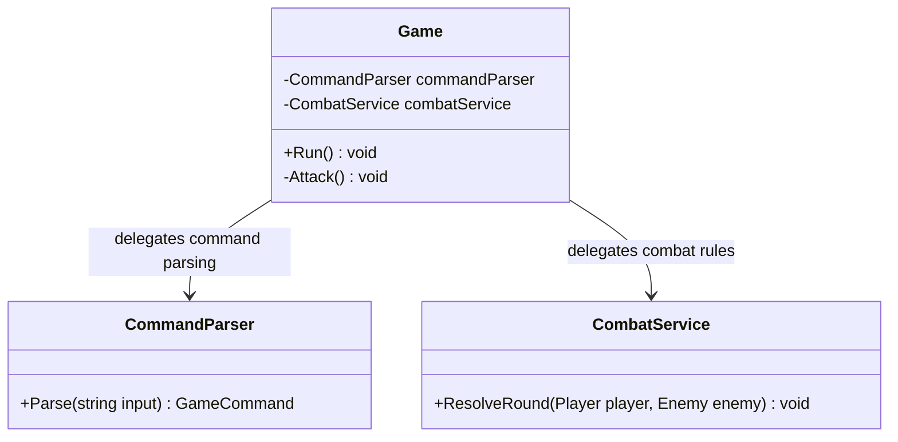
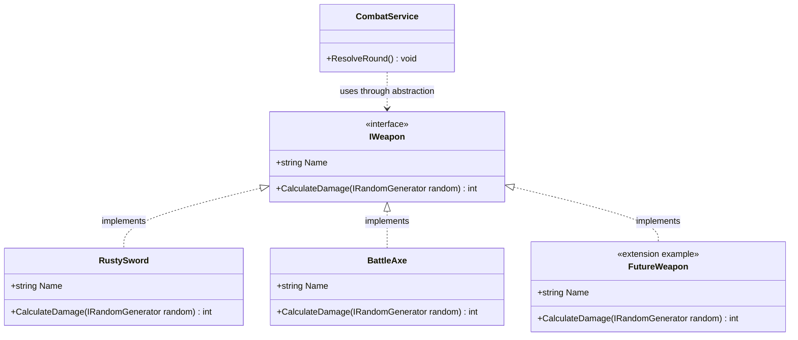
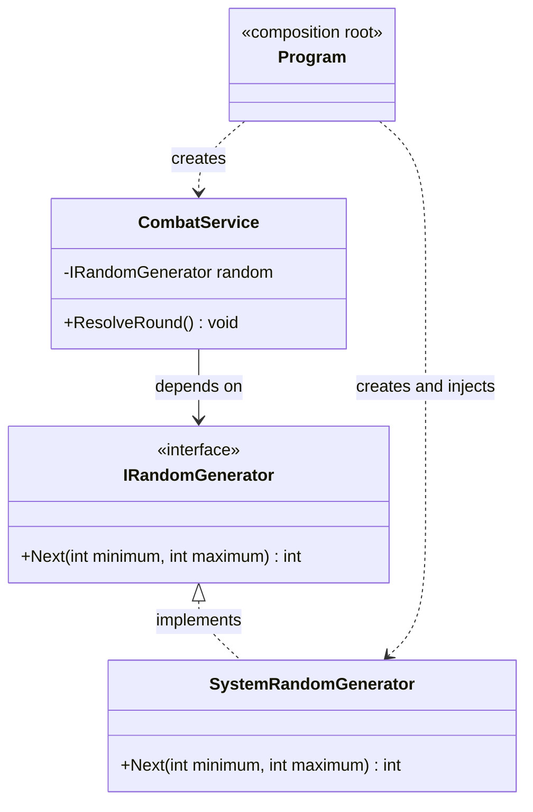

# Laboratory Work No. 1: SOLID Principles

## Objective

The objective of this laboratory work is to create the initial version of a
C# application and apply at least three SOLID principles. The selected project
is a terminal-based dungeon game. Its architecture must remain simple for the
first laboratory while allowing new features and design patterns to be added in
future laboratories.

## Application overview

The application allows the player to explore three connected dungeon rooms,
inspect the current location, move in four directions and fight a skeleton in
turn-based combat. The player can also view their health and equipped weapon,
display the available commands and exit the game.

The terminal uses colors to make important information easier to recognize:
room names are cyan, enemies and errors are red, health and successful actions
are green, weapons and player attacks are yellow, and exits are dark gray.

The available commands are:

```text
look
move <north|east|south|west>
north / east / south / west
attack
stats
help
quit
```

## Project structure

```text
Lab1/
├── Abstractions/     Interfaces for input, output and randomness
├── Application/      Game loop, commands and command parsing
├── Domain/
│   ├── Characters/   Player and enemy entities
│   ├── Items/        Weapon abstraction and weapon implementations
│   └── World/        Rooms and directions
├── Infrastructure/   Console and random-number implementations
├── Services/         Combat rules and initial dungeon configuration
├── Program.cs        Application composition root
└── Lab1.csproj
```

## Applied SOLID principles

### 1. Single Responsibility Principle

#### General definition

The Single Responsibility Principle states that a class should have only one
reason to change. In practice, each class should be responsible for one part of
the system instead of combining unrelated concerns such as input parsing,
business rules, state management and terminal output.

#### Implementation in the application

Responsibilities are divided between focused classes:

- `CommandParser` only converts user text into a `GameCommand`.
- `Game` coordinates the game loop and delegates specialized operations.
- `CombatService` contains the rules for resolving one combat round.
- `Player`, `Enemy` and `Room` manage their own domain state.
- `ConsoleGameInput` reads terminal input.
- `ConsoleGameOutput` displays text and applies terminal colors.
- `InitialDungeon` creates the initial rooms and connects them.

For example, the `Game` class does not calculate random combat damage. It asks
`CombatService` to resolve combat:

```csharp
_combatService.ResolveRound(_player, enemy);
```

Because of this separation, changing command syntax affects `CommandParser`,
while changing combat rules affects `CombatService`. These changes do not need
to be mixed inside one large class.

#### SRP diagram

The following diagram uses command parsing and combat as a focused SRP example.
`Game` coordinates these operations but delegates each specialized
responsibility to a separate class.



Each component has a distinct reason to change. For example, a new command
syntax changes `CommandParser`, while a new combat rule changes
`CombatService`.

UML relationship notation used in the diagrams:

- `-->` represents an association;
- `..>` represents a dependency;
- `<|..` represents interface realization.

### 2. Open/Closed Principle

#### General definition

The Open/Closed Principle states that software entities should be open for
extension but closed for modification. New behavior should normally be added
through new implementations rather than by repeatedly changing stable code.

#### Implementation in the application

Weapons are represented by the `IWeapon` interface:

```csharp
public interface IWeapon
{
    string Name { get; }
    int CalculateDamage(IRandomGenerator random);
}
```

`RustySword` and `BattleAxe` implement this contract and calculate damage in
different ways. `Player` stores an `IWeapon`, and `CombatService` calculates
damage through that interface:

```csharp
int damage = player.EquippedWeapon.CalculateDamage(_random);
```

Therefore, a future `Bow`, `MagicStaff` or another weapon can be added by
creating a new class that implements `IWeapon`. The existing `Player` and
`CombatService` classes do not need weapon-specific `if` or `switch`
statements. `BattleAxe` already demonstrates this extension even though the
initial game equips the player with `RustySword`.

#### OCP diagram

The stable combat logic depends on the `IWeapon` contract. New weapon behavior
is introduced through another implementation rather than by modifying
`CombatService`.



The `FutureWeapon` class represents a possible extension such as a bow or a
magic staff. Adding it does not require a weapon-specific branch in the
existing combat service.

### 3. Dependency Inversion Principle

#### General definition

The Dependency Inversion Principle states that high-level modules should not
depend directly on low-level implementation details. Both should depend on
abstractions. This keeps application logic independent from technologies such
as a particular user interface, storage system or random-number implementation.

#### Implementation in the application

The project defines three infrastructure abstractions:

- `IGameInput` describes how the game receives input.
- `IGameOutput` describes how the game displays information.
- `IRandomGenerator` describes how random values are requested.

The high-level `Game` class depends on `IGameInput` and `IGameOutput`, while
`CombatService` depends on `IRandomGenerator` and `IGameOutput`. They do not
call `Console.ReadLine`, `Console.WriteLine` or `Random.Shared` directly.

The low-level implementations are `ConsoleGameInput`, `ConsoleGameOutput` and
`SystemRandomGenerator`. They are supplied through constructors. `Program.cs`
acts as the composition root where the abstractions are connected to their
concrete implementations:

```csharp
IGameInput input = new ConsoleGameInput();
IGameOutput output = new ConsoleGameOutput();
IRandomGenerator random = new SystemRandomGenerator();

var combatService = new CombatService(random, output);
var game = new Game(player, commandParser, combatService, input, output);
```

This arrangement makes it possible to replace console input, capture output in
tests or use predictable random values without rewriting the game rules.

#### DIP diagram

The arrows below show that high-level application logic communicates through
interfaces. Concrete infrastructure classes implement those interfaces and are
connected to the application only in `Program.cs`.



Consequently, `Game` does not depend directly on `Console.ReadLine`, and
`CombatService` does not depend directly on `Random.Shared`. Tests can inject
alternative implementations without changing the high-level rules.

## Conclusion

In this laboratory work, a functional terminal dungeon game was created in C#
and structured using the Single Responsibility, Open/Closed and Dependency
Inversion principles. SRP separated parsing, combat, domain state and terminal
communication. OCP made the weapon system extensible through `IWeapon`. DIP
isolated the game logic from console and random-number implementations through
interfaces and constructor injection.

The resulting application is small enough to understand and demonstrate, but
its responsibilities and dependencies are separated clearly. This provides a
stable foundation for adding new dungeon features and design patterns in later
laboratories without rewriting the entire project.
