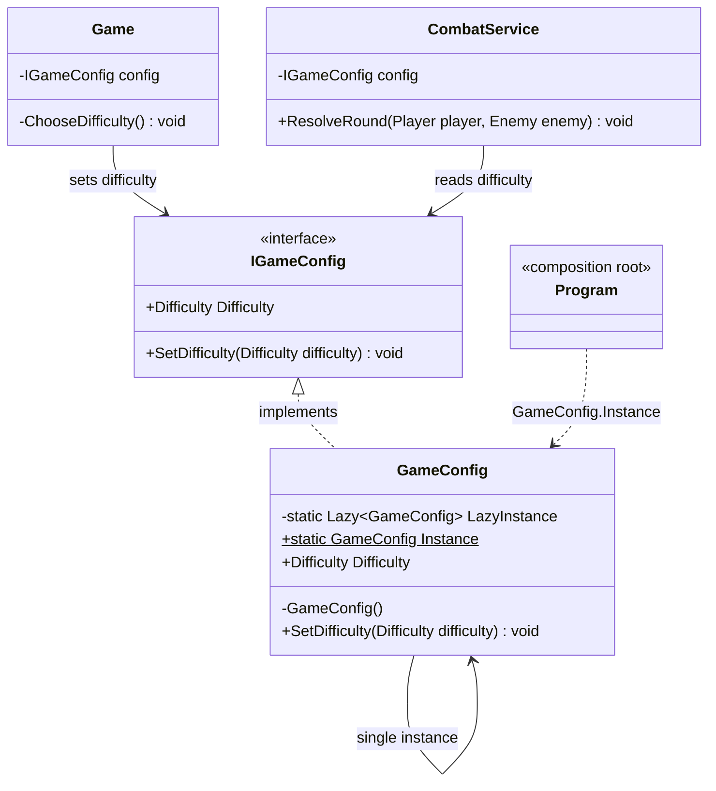
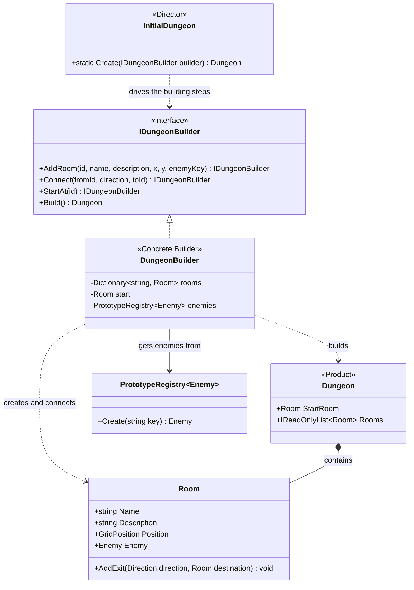
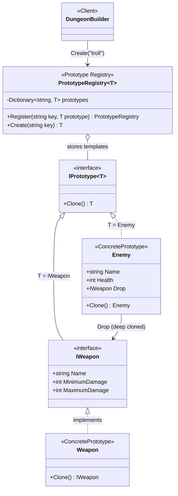
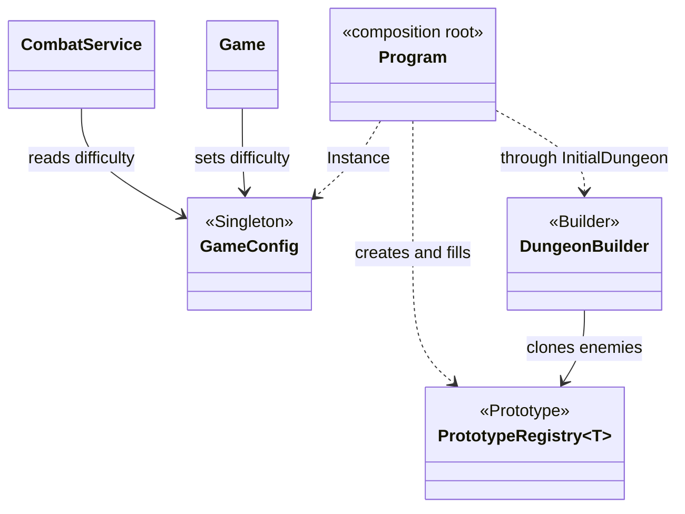

# Laboratory Work No. 2: Creational Design Patterns

## Objective

The objective of this laboratory work is to extend the terminal dungeon game
from Lab 1 and apply at least three creational design patterns. The patterns
chosen for this project are **Singleton**, **Builder** and **Prototype**. Each
pattern solves a concrete problem of the game instead of being added only for
demonstration.

## Application overview

Lab 2 keeps the Lab 1 architecture (input/output/random abstractions, command
parser, combat service) and adds the following gameplay:

- a **difficulty selection** (`easy`, `medium`, `hard`) at the start of the
  game, which biases the damage rolls of the player and of the enemies;
- a larger dungeon of **seven rooms** with a skeleton guard, a troll and a boss
  (the bone drake);
- **weapon drops**: defeated enemies leave a weapon on the floor, which the
  player can pick up (`take`) and use (`equip <weapon>`);
- a **map of the explored rooms** that is printed together with the room
  description when the player uses `look`.

The available commands are:

```text
look
move <north|east|south|west>
north / east / south / west
attack
take
equip <weapon>
stats
help
quit
```

## Project structure

```text
Lab2/
├── Abstractions/     Interfaces for input, output and randomness
├── Application/      Game loop, commands and command parsing
├── Configuration/    Difficulty enum, IGameConfig, GameConfig (Singleton)
├── Domain/
│   ├── Characters/   Player and Enemy (Enemy is a prototype)
│   ├── Items/        IWeapon and Weapon (Weapon is a prototype)
│   ├── Prototypes/   IPrototype<T> and PrototypeRegistry<T>
│   └── World/        Room, Dungeon, Direction, GridPosition
├── Infrastructure/   Console and random-number implementations
├── Services/         DungeonBuilder (Builder), InitialDungeon (Director),
│                     EnemyPrototypes, WeaponPrototypes, CombatService, MapRenderer
├── Program.cs        Application composition root
└── Lab2.csproj
```

UML notation used in the diagrams:

- `-->` represents an association;
- `..>` represents a dependency;
- `<|..` represents interface realization;
- `<|--` represents inheritance;
- `*--` represents composition (the whole creates and owns the part).

---

## Applied creational patterns

### 1. Singleton

#### General definition

Singleton ensures that a class has **exactly one instance** and provides a
global access point to it. The class hides its constructor, keeps the single
instance in a static field and exposes it through a static property or method.

#### Problem in the application

The chosen difficulty must be known by several parts of the game: it is set
when the game starts and it is read every time `CombatService` rolls damage.
Two independent configuration objects would make the game inconsistent (the
player could choose `hard` in one object while combat reads `medium` from
another). The configuration is therefore a good candidate for a single shared
instance.

#### Implementation in the application

`GameConfig` has a private constructor, a static `Lazy<GameConfig>` field and a
static `Instance` property. `Lazy<T>` makes the creation lazy and thread-safe
without manual locking:

```csharp
public sealed class GameConfig : IGameConfig
{
    private static readonly Lazy<GameConfig> LazyInstance = new(() => new GameConfig());

    private GameConfig() { }

    public static GameConfig Instance => LazyInstance.Value;

    public Difficulty Difficulty { get; private set; } = Difficulty.Medium;

    public void SetDifficulty(Difficulty difficulty) => Difficulty = difficulty;
}
```

The instance is obtained only once, in the composition root, and is then
passed to the consumers through the `IGameConfig` interface:

```csharp
IGameConfig config = GameConfig.Instance;
var combatService = new CombatService(random, output, config);
var game = new Game(player, commandParser, combatService, mapRenderer, config, input, output);
```

`Game` writes the difficulty (`SetDifficulty`) and `CombatService` reads it to
decide how the damage rolls are biased.

#### Singleton diagram

The diagram follows the structure from Refactoring Guru: the Singleton class
holds a private static field with its only instance, a private constructor, and
a public static access method. Clients never call `new`.



#### Advantages

- There is a guarantee that only one configuration exists, so every class sees
  the same difficulty.
- `Lazy<T>` gives thread-safe lazy initialization without writing a lock.
- Because consumers receive `IGameConfig` through their constructors, the
  Singleton does not leak into the rest of the code. `CombatService` can be
  tested with a fake `IGameConfig`, and Dependency Inversion from Lab 1 is
  preserved.

#### Disadvantages

- **Global mutable state.** `GameConfig.Instance` is reachable from anywhere
  and `SetDifficulty` can change it at any time. Direct calls would hide a
  dependency; the project limits this by using `GameConfig.Instance` only in
  `Program.cs`, but the language does not enforce it.
- **Single Responsibility Principle is weakened.** `GameConfig` manages both its
  configuration data and its own lifecycle.
- **Testing.** The instance lives for the whole process, so a test that changes
  the difficulty on the real instance leaks into other tests. Tests have to use
  a fake `IGameConfig` instead.

---

### 2. Builder

#### General definition

Builder separates the **construction of a complex object from its
representation**. The object is created step by step through a sequence of
calls, and the same construction process can produce different results.
Refactoring Guru describes four participants: the *Builder* interface with the
building steps, *Concrete Builders* that implement them, an optional *Director*
that defines the order of the steps, and the *Product* that is built.

#### Problem in the application

The dungeon in Lab 2 contains seven rooms with names, descriptions, grid
positions, optional enemies and bidirectional exits. Building it with a
constructor, or with a long list of `new Room(...)` and `AddExit(...)` calls,
would be hard to read and easy to get wrong. A particular source of mistakes is
that every exit has to be added **twice** (north from A and south from B).

#### Implementation in the application

The `IDungeonBuilder` interface declares the construction steps. `DungeonBuilder`
is the concrete builder; its steps return `this`, so the calls form a fluent
chain:

```csharp
public interface IDungeonBuilder
{
    IDungeonBuilder AddRoom(string id, string name, string description,
                            int x, int y, string? enemyKey = null);
    IDungeonBuilder Connect(string fromId, Direction direction, string toId);
    IDungeonBuilder StartAt(string id);
    Dungeon Build();
}
```

`Connect` hides the double registration of the exits:

```csharp
_rooms[fromId].AddExit(direction, _rooms[toId]);
_rooms[toId].AddExit(direction.Opposite(), _rooms[fromId]);
```

`Build()` validates the result (a start room must exist) and returns the
finished `Dungeon` product. `InitialDungeon.Create` plays the role of the
*Director*: it knows which rooms and connections make the first level:

```csharp
public static Dungeon Create(IDungeonBuilder builder)
{
    return builder
    .AddRoom("gate", "Old Gate", "Cold air flows through a cracked stone archway.", 0, 2)
    .AddRoom("crypt", "Dusty Crypt", "Faded names cover the walls...", 0, 1, "skeleton-guard")
    // ... four more rooms
    .Connect("gate", Direction.North, "crypt")
    .Connect("crypt", Direction.East, "shrine")
    // ... more connections
    .StartAt("gate")
    .Build();
}
```

The Director depends only on `IDungeonBuilder`; `Program.cs` chooses the concrete
builder: `InitialDungeon.Create(new DungeonBuilder(enemies))`. Another level
could be created by writing another Director method, and another kind of
dungeon (for example a random one) by writing another `IDungeonBuilder`.

#### Builder diagram



#### Advantages

- **Readable construction.** The fluent chain reads almost like a description
  of the level, much clearer than seven `new Room(...)` calls and fourteen
  `AddExit` calls.
- **Less duplicated code.** `Connect` creates both directions of an exit, which
  removes a whole class of "one-way door" mistakes.
- **Validation in one place.** `Build()` is the single place where an
  incomplete dungeon is rejected.
- **Single Responsibility Principle is respected.** Construction logic is
  separated from the `Room` and `Dungeon` classes, which only keep domain
  state, and from `InitialDungeon`, which only decides *what* to build.
- The builder reuses the enemy prototypes (`enemyKey`), so the two patterns
  cooperate.

#### Disadvantages

- **More code.** A new class with four methods is added only to assemble a
  structure that could be created in one method.
- **Interface used by one builder only.** Only `DungeonBuilder` implements
  `IDungeonBuilder`, so the abstraction is prepared for a second builder (for
  example a random dungeon generator) that does not exist yet.
- **Weak compile-time safety.** Rooms are referenced by string ids. A typo in
  `Connect("gat", ...)` compiles and fails only at runtime with a
  `KeyNotFoundException`.

---

### 3. Prototype

#### General definition

Prototype creates new objects by **copying an existing object**, called the
prototype, instead of constructing them from scratch. The client does not need
to know the concrete class of the copied object: it only calls `Clone()` on an
interface. Refactoring Guru also describes the *Prototype Registry*, a store of
ready-made prototypes that can be requested by name.

#### Problem in the application

The same kind of enemy appears several times and the same weapon can be
dropped many times. Every instance must be independent: if two skeletons
shared one object, damaging one would damage both. Writing
`new Enemy("skeleton guard", 12, 2, 5, new Weapon("Iron Sword", 4, 8))` in each
place would duplicate the statistics and make balancing difficult, because a
single stat change would need to be repeated everywhere.

#### Implementation in the application

A generic interface describes the cloning contract:

```csharp
public interface IPrototype<out T>
{
    T Clone();
}
```

`Weapon` and `Enemy` implement it. `IWeapon` itself extends
`IPrototype<IWeapon>`, so any weapon can be cloned through the abstraction.
`Enemy.Clone` creates a **deep copy**, because the enemy owns its dropped
weapon:

```csharp
public Enemy Clone()
{
    return new Enemy(Name, Health, MinimumDamage, MaximumDamage,
                     Drop?.Clone(), IsBoss);
}
```

`PrototypeRegistry<T>` stores the templates under string keys and returns a
fresh clone on every request:

```csharp
public T Create(string key)
{
    if (!_prototypes.TryGetValue(key, out T? prototype))
        throw new KeyNotFoundException($"No prototype registered as '{key}'.");

    return prototype.Clone();
}
```

The registries are filled in two small classes, so all the statistics are in
one place:

```csharp
new PrototypeRegistry<Enemy>()
    .Register("skeleton-guard", new Enemy("skeleton guard", 12, 2, 5, weapons.Create("iron-sword")))
    .Register("troll",          new Enemy("troll", 20, 4, 7, weapons.Create("battle-axe")))
    .Register("bone-drake",     new Enemy("bone drake", 30, 5, 9, isBoss: true));
```

`DungeonBuilder` asks the registry for enemies (`_enemies.Create(enemyKey)`) and
`Program` asks the weapon registry for the starting `rusty-sword`.

#### Prototype diagram



#### Advantages

- **Independent copies.** Every call to `Create` returns a new object, so
  damaging one troll does not affect another.
- **No duplicated statistics.** Balancing an enemy means editing one line in
  `EnemyPrototypes`.
- **Clients depend on abstractions.** The caller of `Create` does not need to
  know how to build an `Enemy` or which weapon it carries. This also fits
  Dependency Inversion and the *Open/Closed Principle*: a new enemy type is a
  new `Register` line, without touching the builder.
- The generic `PrototypeRegistry<T>` is reused for both enemies and weapons.

#### Disadvantages

- **Cloning must be maintained manually.** `Enemy.Clone` repeats the
  constructor parameters. If a new field is added to `Enemy` and `Clone` is not
  updated, copies will silently lose that field. Deep copy (`Drop?.Clone()`) is
  also the programmer's responsibility.
- **The pattern gives little benefit for `Weapon`.** `Weapon` is immutable, so
  sharing one instance would be safe, and `Clone` only creates an identical
  object. The pattern is justified for the mutable `Enemy` but is mostly formal
  for weapons.
- **Side effect on Lab 1 design.** A single `Weapon` class holds a damage range
  and `CombatService` does the rolling. This weakens the *Open/Closed
  Principle*: a weapon with special behavior can no longer be added without
  changing `CombatService`.

---

## How the patterns work together



`Program.cs` creates the weapon registry, uses it to create the enemy
registry, passes the enemy registry to the Director (`InitialDungeon`) that
drives `DungeonBuilder`, and finally gives the single `GameConfig` to the
services. The start of the game therefore reads as a short sequence:

```csharp
var weapons = WeaponPrototypes.CreateRegistry();
var enemies = EnemyPrototypes.CreateRegistry(weapons);
var dungeon = InitialDungeon.Create(enemies);
```

## Impact on the SOLID principles from Lab 1

| Principle | Status in Lab 2 |
|-----------|-----------------|
| Single Responsibility | Mostly kept. Builder improves it, but Singleton (`GameConfig`) and Prototype (`Clone` in entities) add a second concern to their classes, and `Game` also handles the difficulty prompt. |
| Open/Closed | Weakened. Enemies and rooms can be added with data only, but `CombatService` contains a `switch` on `Difficulty` and weapons no longer carry their own damage behavior. |
| Dependency Inversion | Kept for the Singleton (consumers use `IGameConfig`), and the Builder also follows it: `InitialDungeon` depends on `IDungeonBuilder`. The concrete `DungeonBuilder` is chosen only in `Program.cs`. |

## Conclusion

In this laboratory work the Lab 1 dungeon game was extended with three
creational patterns. **Singleton** (`GameConfig`) provides one shared
difficulty setting. **Builder** (`DungeonBuilder`, with `InitialDungeon` as the
Director) makes the construction of the seven-room dungeon readable and hides
the double registration of exits. **Prototype** (`IPrototype<T>`,
`PrototypeRegistry<T>`, `Enemy`, `Weapon`) creates independent enemies and
weapons from registered templates.

Every pattern brought a benefit but also a cost. Singleton introduced global
state that had to be limited with an interface and a single access point in the
composition root. Builder added a class and string-based references that fail
only at runtime. Prototype requires careful, manually maintained deep copying
and pushed damage logic out of the weapons, which partly reduced the
extensibility achieved in Lab 1. These trade-offs show that creational
patterns should be selected when the problem justifies them, as with the
mutable `Enemy` clones and the dungeon construction, and not applied to every
class, as the nearly redundant cloning of the immutable `Weapon` demonstrates.
